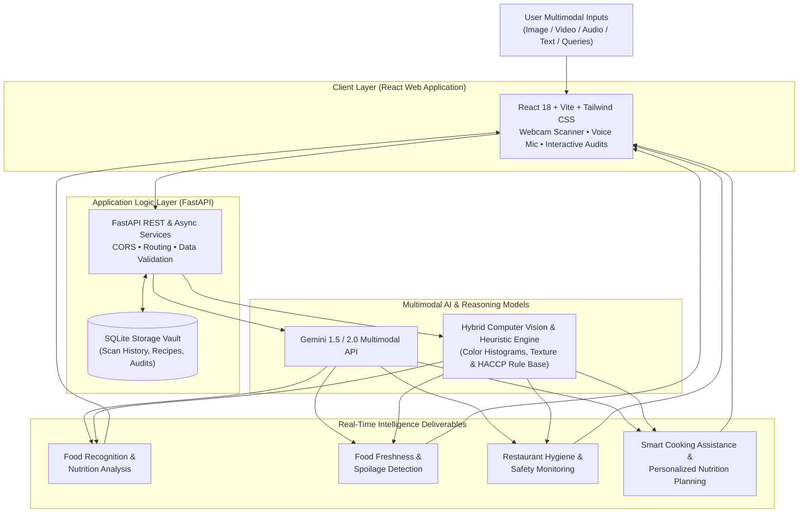

# 🥗 FoodVerse AI — Multimodal Food Intelligence Agent

[](https://fastapi.tiangolo.com)
[](https://react.dev)
[](https://tailwindcss.com)
[](https://python.org)
[](LICENSE)
[-brightgreen.svg)]()

> **FoodVerse AI** is an advanced, multimodal AI-powered food intelligence platform unifying computer vision, video stream analysis, and large language model-driven reasoning to deliver real-time insights across food recognition, freshness detection, restaurant hygiene monitoring, smart cooking assistance, and personalized nutrition planning.

---

## 🌟 Executive Summary

In modern households, commercial restaurant kitchens, and food service environments, food-related decision-making is fragmented and reactive:
- **Nutrition tracking** relies on tedious manual calorie estimations.
- **Perishable freshness** is judged visually without scientific validation, causing excessive food waste or food poisoning hazards.
- **Restaurant kitchen hygiene monitoring** relies on infrequent, periodic manual inspections rather than proactive detection.
- **Cooking assistance** is largely confined to static recipe pages without contextual ingredient substitutions or hands-free voice guidance.

**FoodVerse AI** bridges these gaps by providing a modular, extensible, multimodal platform operating across **5 core epics**:
1. **Epic 1: Requirements Specification & Environment Setup** — Clean decoupled FastAPI backend, React (Vite + Tailwind CSS) client, and persistent SQLite audit storage.
2. **Epic 2: Food Recognition & Nutrition Module** — Computer vision ingredient detection, estimated portion weights, macronutrient and calorie profiling, glycemic index derivation, and Nutri-Score calculation.
3. **Epic 3: Food Freshness & Spoilage Detection Module** — Multi-factor visual diagnostic radar assessing surface discoloration, fungal mycelium/mold, moisture loss, and generating shelf-life countdowns with HACCP consumption safety verdicts.
4. **Epic 4: Restaurant Hygiene & Smart Kitchen Safety Module** — Automated CCTV and workstation scanner verifying PPE mandates (chef hairnets, gloves, masks), cross-contamination vectors, and HACCP compliance scores (Grade A-F).
5. **Epic 5: Smart Cooking Assistance & Personalized Nutrition Planning** — Conversational AI Chef, dynamic culinary substitutions, hands-free Web Speech API voice guidance, and customized weekly/daily meal planning.

---

## 🏗️ System Architecture



---

## 🚀 Key Features by Epic

### 🍏 Epic 2: Food Recognition & Nutrition
- **Multimodal Visual Classifier**: Identifies food items, individual components, and garnish layers from camera snapshots or file uploads.
- **Portion & Macronutrient Breakdown**: Estimates weight in grams, total calories (kcal), protein (g), carbohydrates (g), fats (g), fiber (g), sugar, and sodium.
- **Nutri-Score Rating**: Derives an automated nutritional density rating (Grade A through E).
- **Dietary Tagging**: Evaluates compliance across Vegan, Keto-Friendly, High-Protein, Gluten-Free, and Dairy-Free lifestyles.
- **Clinical Guidance**: Delivers actionable metabolic insights on glycemic response and insulin stability.

### 🔬 Epic 3: Food Freshness & Spoilage Detection
- **Microbial & Spoilage Vector Scanner**: Inspects produce, dairy, meats, and baked goods for enzymatic browning, moisture loss, and mold outbreaks (*Penicillium*, *Botrytis cinerea*).
- **Freshness Score Meter**: Real-time 0–100% dial with clear classification (`Fresh & Prime Quality`, `Safe - Consume Soon`, `Spoiled / High Risk - Discard`).
- **Shelf-Life Countdown**: Estimates remaining edible shelf life in days and hours.
- **HACCP Preservation Advice**: Temperature, crisper drawer humidity, and contamination prevention protocols.

### 🛡️ Epic 4: Restaurant Hygiene & Safety Monitoring
- **Automated PPE Auditing**: Detects employee adherence to chef hats/hairnets, sterile disposable nitrile gloves, face masks, and clean protective aprons.
- **Cross-Contamination Radar**: Flags critical hazards like raw poultry placed in close proximity to ready-to-eat produce.
- **Sanitation Scorecard**: Generates commercial inspection letter grades (**Grade A**, **Grade B**, **Grade C**, **Grade F**) with quantitative percentages.
- **HACCP Corrective Action Ledger**: Provides timestamped remediation procedures for every detected violation.
- **Live Video CCTV Stream Simulation**: Demonstrates real-time continuous video frame ingestion.

### 👨‍🍳 Epic 5: Smart Cooking & Nutrition Planning
- **Pantry-to-Recipe Generator**: Transforms detected ingredients into gourmet, chef-tested recipes tailored to skill level and cuisine.
- **Dynamic Culinary Substitutions**: Intelligent alternatives for eggs, buttermilk, wheat flour, heavy cream, soy sauce, and oils.
- **Hands-Free Voice Coaching**: Built-in Web Speech API voice speech recognition and Text-to-Speech audio step narration.
- **Personalized Weekly Meal Planner**: Tailored calorie goals (1,500 – 3,500 kcal/day), macro splits, and auto-generated grocery shopping lists.

---

## 🛠️ Technology Stack

| Layer | Technologies |
| :--- | :--- |
| **Frontend** | React 18, Vite 5, Tailwind CSS, Lucide Icons, Web Speech API, Canvas Confetti |
| **Backend** | Python 3.10+, FastAPI, Uvicorn, Pydantic v2, Pillow (PIL), Httpx |
| **AI Models** | Google Gemini 1.5/2.0 Multimodal API + Hybrid Edge Computer Vision Heuristics |
| **Database** | SQLite3 (Audit Vault, Saved Recipes, Historical Scans) |
| **Testing** | Pytest test suite (11 unit and integration test assertions) |

---

## ⚡ Quick Start Guide

### 1. Prerequisites
- **Python**: Version 3.8 or above (Installed & verified with `python --version`)
- **Node.js**: Version 18+ (Installed & verified with `node --version`)
- **Git**: Installed & configured

### 2. Installation

Clone or navigate to the repository directory:
```bash
git clone https://github.com/<your-username>/FoodVerse-AI.git
cd FoodVerse-AI
```

Install backend dependencies:
```bash
pip install -r requirements.txt
```

Install frontend dependencies:
```bash
cd frontend
npm install
cd ..
```

---

### 3. Running the Application

#### Option A: One-Click Launcher (Windows)
Run the automated PowerShell startup script:
```powershell
.\run.ps1
```
*(Or double click `run.bat`)*

#### Option B: Manual Startup

**Terminal 1 — FastAPI Backend:**
```bash
cd backend
python -m uvicorn app.main:app --host 0.0.0.0 --port 8000 --reload
```
*Backend Swagger Docs will be available at:* `http://localhost:8000/docs`

**Terminal 2 — React Client:**
```bash
cd frontend
npm run dev
```
*Frontend Web App will be available at:* `http://localhost:3000`

---

## 🧪 Running the Pytest Test Suite

Execute the automated test suite covering all 4 Epics and API routers:
```bash
$env:PYTHONPATH = "backend"
python -m pytest backend/tests -v
```

**Test Coverage Summary:**
- `test_root_endpoint` — Validates server status & version metadata
- `test_health_check` — Confirms database connectivity & AI engine state
- `test_nutrition_samples` & `test_nutrition_analyze_sample` — Validates Epic 2
- `test_freshness_samples` & `test_freshness_inspect` — Validates Epic 3
- `test_hygiene_samples` & `test_hygiene_audit` — Validates Epic 4
- `test_cooking_recipe` & `test_cooking_chat_substitution` — Validates Epic 5
- `test_meal_plan_generator` — Validates Personalized Nutrition Planner

---

## 🌐 Connecting Live Gemini Multimodal API (Optional)

The application includes an intelligent offline simulation and heuristic computer vision engine that works **100% out of the box** without any API keys. 

To connect live Google Gemini Multimodal Vision:
1. Obtain an API key from [Google AI Studio](https://aistudio.google.com/).
2. Click **API Config** in the top navigation bar of the web application.
3. Paste your Gemini API Key and click **Save & Activate**.
*(Alternatively, set `GEMINI_API_KEY=your_key_here` in a `.env` file inside the project root).*

---

## 📤 Step-by-Step GitHub Upload Guide

To submit this project to your learning platform portal using the **"Add Github Link"** button:

1. **Initialize Git and Commit All Files:**
   ```bash
   git init
   git add .
   git commit -m "feat: complete FoodVerse AI multimodal platform (Epics 1-5)"
   ```

2. **Create a New Repository on GitHub:**
   - Go to [GitHub.com/new](https://github.com/new)
   - Repository name: `FoodVerse-AI`
   - Select **Public**
   - Click **Create repository**

3. **Push to Your GitHub Repository:**
   ```bash
   git branch -M main
   git remote add origin https://github.com/<YOUR_GITHUB_USERNAME>/FoodVerse-AI.git
   git push -u origin main
   ```

4. **Submit to Portal:**
   - Copy your GitHub URL: `https://github.com/<YOUR_GITHUB_USERNAME>/FoodVerse-AI`
   - Click the **"Add Github Link"** button on your assignment dashboard and paste the link!

---

## 📄 License
This project is open-source and available under the [MIT License](LICENSE).
